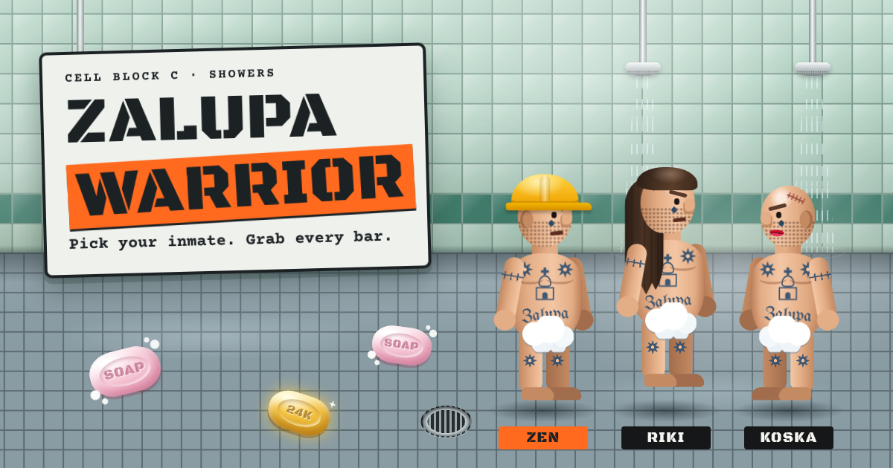

# Zalupa Warrior

A browser game set in the Cell Block C showers. Pick your inmate (Zen, Riki or Koska), then steer him around the wet floor and grab every bar of soap before it slides out the other side.

It's one HTML file with its own CSS and JavaScript. There is no build step and nothing to install.



## How to play

| Input | What it does |
| --- | --- |
| Mouse | He runs to wherever the pointer is |
| Touch | Tap or drag on the floor and he runs there |
| Arrow keys or WASD | Run |
| Space | Start a shift |
| P or Esc | Pause |

- Run into soap to pick it up. Three bars getting away ends the shift.
- Gold soap is worth 5×, and catch streaks raise the multiplier up to ×5.
- Green soap switches on a magnet for 7 seconds: any soap that comes near your inmate gets pulled straight to him.
- Don't step on the roaches. Each one costs a strike.
- The game speeds up every 5 bars caught.

Your personal best and chosen inmate are saved in the browser's local storage.

## Run it locally

Open `index.html` in a browser, or serve the folder:

```bash
npx serve .
```

## Deploy to Vercel

1. In Vercel, choose **Add New → Project** and import this GitHub repository.
2. Leave **Framework Preset** on **Other**. Leave the build command and output directory empty.
3. Click **Deploy**.

Vercel deploys the repository's default branch to production. Every push to that branch redeploys the site, and other branches get preview URLs.

To deploy from a terminal instead:

```bash
npx vercel --prod
```

## Files

| File | Purpose |
| --- | --- |
| `index.html` | The whole game: markup, styles and script |
| `favicon.svg` | Browser tab icon |
| `apple-touch-icon.png`, `icon-192.png`, `icon-512.png` | Home-screen icons for iPhone and Android |
| `site.webmanifest` | Lets phones add the game to the home screen as a full-screen app |
| `og-image.png` | Preview image shown when the link is shared |
| `vercel.json` | Security headers for the Vercel deployment |
